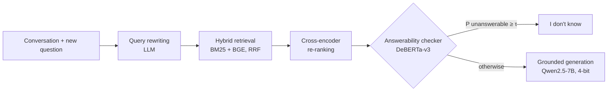

# Knowing When Not to Answer: Abstention Drift in Multi-Turn Retrieval-Augmented Conversations

> A multi-turn RAG assistant that knows when its evidence can't answer, and a study of whether that ability degrades as a conversation goes on.

CS683 (NLP) course project · built on [MTRAG](https://github.com/IBM/mt-rag-benchmark) (TACL 2025) and SemEval-2026 Task 8 (MTRAGEval)

<!-- Replace with a GIF of app/app.py once the demo runs -->
<!--  -->

## Why this matters

RAG assistants often answer confidently even when the retrieved documents do not contain the answer. In SemEval-2026 Task 8, one of the strongest systems (AILS-NTUA, 1st in retrieval) reached 83.9% answerability accuracy but caught only **21.8% of unanswerable turns** ([AILS-NTUA, 2026](https://arxiv.org/abs/2603.10524)). Research on abstention is almost entirely single-turn. **We ask whether abstention gets worse deeper into a conversation.**

## Research questions

| | Question | How we measure it |
|---|---|---|
| **RQ1** | Does detection of unanswerable questions get worse at later turns? | Abstention recall per turn bucket; the *abstention drift* slope with a conversation-level bootstrap CI; a logistic regression controlling for domain and follow-up type; a controlled probe on synthetic data |
| **RQ2** | Can a lightweight checker, trained on unanswerable examples generated cheaply, fix this without hurting answerable turns? | Abstention F1 and drift for S0–S4, with the false-abstention rate on answerable turns capped at 5% |

## System



**Key idea: evidence removal.** Only 6.5% of MTRAG turns are unanswerable, too few to train on. For every *answerable* turn we know which passages contain the answer. Retrieving again while excluding every passage from those source documents produces a realistic context that no longer supports the answer, so each answerable turn yields an unanswerable one at no annotation cost. Answerable training examples are *also* built from retrieval (with the gold passages inserted), so the checker can't learn "gold passages look different". A synthetic example is dropped when the remaining passages still cover the reference answer, checked lexically and optionally by an LLM (`--verify-llm`).

## Data at a glance (real numbers, `scripts/dataset_stats.py`)

| Dataset | Tasks | Unanswerable | Early turns (1–2) | Mid turns (3–5) | Late turns (6+) |
|---|---|---|---|---|---|
| MTRAG (train/dev) | 842 (110 conversations) | 55 (6.5%) | 5.0% | 6.8% | 7.4% |
| MTRAG-UN (held-out test) | 507 | 97 (19.1%) | 9.4% | 13.8% | 33.7% |

Unanswerable questions cluster in late turns, especially in MTRAG-UN, so a raw per-turn comparison is **confounded**: a recall drop could come from *which* questions appear late rather than from the turn itself. We address this with (a) a logistic regression controlling for domain and follow-up type, and (b) the **synthetic probe**. Evidence removal creates an unanswerable version of every answerable dev turn at every position, so only the passages change.

## Experiments

| ID | Rewriting | Retrieval | Abstention | Purpose |
|---|---|---|---|---|
| S0 | last turn only | BM25 | prompt only | weak baseline |
| S1 | LLM rewrite | BM25 | prompt only | effect of rewriting |
| S2 | LLM rewrite | BM25 + BGE + re-rank | prompt only | strong baseline |
| S3 | LLM rewrite | BM25 + BGE + re-rank | checker (real labels only) | ablation |
| **S4** | LLM rewrite | BM25 + BGE + re-rank | **checker (real + synthetic)** | **proposed** |
| S4-oracle | human rewrites | BM25 + BGE + re-rank | checker (real + synthetic) | upper bound |

Answer quality (faithfulness, RB_llm, IDK-conditioned scores) is measured with the **official MTRAG evaluation scripts**, since our prediction files use their format.

### Results

_To be filled in; `scripts/evaluate_abstention.py` writes `results/abstention.md` and `results/drift.png`._

| System | Abstain F1 | Recall early / mid / late | Drift slope [95% CI] | False-abstention | RB_llm |
|---|---|---|---|---|---|
| S0 | | | | | |
| S2 | | | | | |
| S4 | | | | | |

## Quickstart

**Windows laptop with a 4 GB GPU?** Follow [docs/windows_laptop.md](docs/windows_laptop.md) and use `configs/laptop.yaml`.

```bash
git clone <this repo> && cd abstention-drift
pip install -r requirements.txt && pip install -e .
bash scripts/setup_data.sh                       # MTRAG + MTRAG-UN (Apache-2.0)
python scripts/dataset_stats.py                  # CPU, 2 s: reproduces the table above
pytest -q                                        # 14 unit tests

# CPU-only smoke run (FiQA, BM25, human rewrites): builds checker data in ~10 s
python scripts/build_indexes.py --collections fiqa --no-dense
python scripts/make_checker_data.py --rewrite oracle --no-dense --no-rerank --collections fiqa
```

Full pipeline (Colab or Kaggle T4, 16 GB):

```bash
python scripts/build_indexes.py                              # ~20-30 min, all 4 domains
python scripts/make_checker_data.py --rewrite llm            # add --verify-llm for cleaner synthetic labels
python scripts/train_checker.py                              # S4 checker  (~30-45 min)
python scripts/train_checker.py --real-only                  # S3 ablation
for S in S0 S1 S2 S3 S4; do python scripts/run_pipeline.py --system $S --split mtragun; done
python scripts/run_synthetic_probe.py --who checker          # controlled RQ1 probe
python scripts/run_synthetic_probe.py --who generator --limit 300
python scripts/evaluate_abstention.py outputs/S*_mtragun.jsonl outputs/probe_*.jsonl
python app/app.py                                            # demo
```

Model sizes can be overridden without editing files, for example: `python scripts/run_pipeline.py --system S2 --split dev --set llm.model=Qwen/Qwen2.5-1.5B-Instruct`.

## Repository layout

```
configs/default.yaml        all hyper-parameters in one place
src/abstain/
  data.py                   MTRAG / MTRAG-UN loaders, conversation-level splits, turn buckets
  retrieval.py              BM25 (bm25s), dense BGE + FAISS, RRF fusion, cross-encoder re-ranking
  rewrite.py                query rewriting (last-turn / history / oracle / LLM)
  generate.py, idk.py       grounded generation + "I don't know" detection
  synth.py                  evidence-removal synthetic unanswerables (+ lexical / LLM filters)
  checker.py                DeBERTa answerability checker + threshold under a false-abstention budget
  metrics.py                abstention P/R/F1, per-bucket report, drift slope + cluster bootstrap, controlled logit
  pipeline.py               end-to-end system, MTRAG-format predictions
scripts/                    one script per step (see Quickstart)
app/app.py                  Gradio demo (sources + P(unanswerable) meter)
tests/                      unit tests for metrics, synthesis, thresholding, IDK detection
docs/                       proposal, 2-page report outline, team plan
notebooks/colab_quickstart.ipynb   one-domain end-to-end run on a free T4
```

## Team and plan

See [docs/team_plan.md](docs/team_plan.md) for the 4-week plan and role split.

## Limitations

- **Noisy synthetic labels.** Another document may still answer the question. We filter lexically and optionally with an LLM, then hand-check 50 examples and report the residual noise rate.
- **Few real unanswerables.** MTRAG has 55 and MTRAG-UN 97, so confidence intervals are wide. The synthetic probe adds statistical power but measures a proxy.
- **Distribution shift.** The generator and checker are English-only and use 4 of MTRAG-UN's 6 domains (Banking and Telco are not yet released).

## Citation

```bibtex
@article{katsis2025mtrag,
  title   = {MTRAG: A Multi-Turn Conversational Benchmark for Evaluating Retrieval-Augmented Generation Systems},
  author  = {Katsis, Yannis and Rosenthal, Sara and others},
  journal = {Transactions of the Association for Computational Linguistics},
  volume  = {13}, pages = {784--808}, year = {2025}
}
```

Also cite MTRAG-UN (Rosenthal et al., Findings ACL 2026) and SemEval-2026 Task 8 (Rosenthal et al., 2026). BibTeX is in the [MTRAG README](https://github.com/IBM/mt-rag-benchmark).

Code: MIT. Data: MTRAG is Apache-2.0 and is downloaded, not redistributed.
