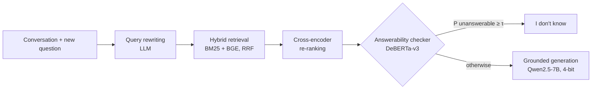

# Knowing When Not to Answer: Abstention Drift in Multi-Turn Retrieval-Augmented Conversations

> A multi-turn RAG assistant that knows when its evidence can't answer, and a study of whether that ability degrades as a conversation goes on.

CS683 (NLP) course project · built on [MTRAG](https://github.com/IBM/mt-rag-benchmark) (TACL 2025) and SemEval-2026 Task 8 (MTRAGEval)

<!-- Replace with a GIF of app/app.py once the demo runs -->
<!--  -->

## Why this matters

RAG assistants often answer confidently even when the retrieved documents do not contain the answer. In SemEval-2026 Task 8, one of the strongest systems (AILS-NTUA, 1st in retrieval) reached 83.9% answerability accuracy but caught only **21.8% of unanswerable turns** on the development set ([AILS-NTUA, SemEval-2026](https://aclanthology.org/2026.semeval-1.175/)). Research on abstention is almost entirely single-turn. **We ask whether abstention gets worse deeper into a conversation.**

## Research questions

| | Question | How we measure it |
|---|---|---|
| **RQ1** | Does detection of unanswerable questions get worse at later turns? | Abstention recall per turn bucket; the *abstention drift* slope with a conversation-level bootstrap CI; a logistic regression controlling for domain and follow-up type; a controlled probe on synthetic data |
| **RQ2** | Can a lightweight checker, trained on unanswerable examples generated cheaply, fix this without hurting answerable turns? | Abstention F1 and drift for S0–S4, with the false-abstention rate on answerable turns capped at 5% |

## System



**Key idea: evidence removal.** Only 6.5% of MTRAG turns are unanswerable, too few to train on. For every *answerable* turn we know which passages contain the answer. Retrieving again while excluding every passage from those source documents produces a realistic context that no longer supports the answer, so each answerable turn yields an unanswerable one at no annotation cost. Answerable training examples are *also* built from retrieval (with the gold passages inserted), so the checker can't learn "gold passages look different". A synthetic example is dropped when the remaining passages still cover the reference answer, checked lexically and optionally by an LLM (`--verify-llm`).

## Data at a glance (real numbers, `scripts/dataset_stats.py`)

| Dataset | Tasks | Unanswerable | Early turns (1–2) | Mid turns (3–5) | Late turns (6+) |
|---|---|---|---|---|---|
| MTRAG (train/dev) | 842 (110 conversations) | 55 (6.5%) | 5.0% | 6.8% | 7.4% |
| MTRAG-UN (held-out test) | 507 | 97 (19.1%) | 9.4% | 13.8% | 33.7% |

Unanswerable questions cluster in late turns, especially in MTRAG-UN, so a raw per-turn comparison is **confounded**: a recall drop could come from *which* questions appear late rather than from the turn itself. We address this with (a) a logistic regression controlling for domain and follow-up type, and (b) the **synthetic probe**. Evidence removal creates an unanswerable version of every answerable dev turn at every position, so only the passages change.

## Experiments

| ID | Rewriting | Retrieval | Abstention | Purpose |
|---|---|---|---|---|
| S0 | last turn only | BM25 | prompt only | weak baseline |
| S1 | LLM rewrite | BM25 | prompt only | effect of rewriting |
| S2 | LLM rewrite | BM25 + BGE + re-rank | prompt only | strong baseline |
| S3 | LLM rewrite | BM25 + BGE + re-rank | checker (real labels only) | ablation |
| **S4** | LLM rewrite | BM25 + BGE + re-rank | **checker (real + synthetic)** | **proposed** |
| S4-oracle | human rewrites | BM25 + BGE + re-rank | checker (real + synthetic) | upper bound |

Our prediction files use the MTRAG format, so answer quality (faithfulness, RB_llm, IDK-conditioned scores) can be measured with the **official MTRAG evaluation scripts**; this was not part of the reported results.

### Results

MTRAG-UN held-out test set, 429 turns (97 unanswerable). FA = share of answerable turns wrongly refused;
drift slope = change in abstention recall per extra turn, with a 95% conversation-bootstrap confidence interval.
Full tables: [`results/abstention.md`](results/abstention.md), [`results/agent_comparison.md`](results/agent_comparison.md)
and the [project report](docs/CS683_Project_Report.pdf) (Chapters on main results, RQ1 and RQ2).

| System | Abstain F1 | Recall | Precision | FA ↓ | Recall early / mid / late | Drift slope [95% CI] |
|---|---|---|---|---|---|---|
| S0 | .451 | **.567** | .374 | .277 | .538 / .536 / .589 | −.002 [−.048, +.046] |
| S1 | .453 | .526 | .398 | .232 | .462 / .500 / .554 | −.005 [−.051, +.041] |
| S2 | .443 | .464 | .425 | .184 | .538 / .393 / .482 | −.003 [−.046, +.043] |
| S2-rr | .473 | .546 | .417 | .223 | .538 / .464 / .589 | +.011 [−.031, +.057] |
| S3 | .457 | .515 | .410 | .217 | .538 / .429 / .554 | +.011 [−.030, +.055] |
| S4 | .449 | .495 | .410 | .208 | .538 / .393 / .536 | +.008 [−.034, +.051] |
| S5 agent: retry only | .465 | .443 | **.489** | **.136** | .462 / .357 / .482 | +.010 [−.033, +.054] |
| **S5 agent: retry + selective self-check** | **.511** | .577 | .459 | .199 | .538 / .500 / .625 | +.020 [−.026, +.068] |

Turn buckets: early = turns 1–2 (13 unanswerable / 90 answerable), mid = 3–5 (28 / 135), late = 6+ (56 / 107).

**Findings**

- **No abstention drift.** Every recall slope lies between −.005 and +.020 per turn and every confidence interval
  contains zero; with domain and follow-up type controlled the odds ratio per turn is 0.97–1.10. The controlled
  probe (444 unanswerable examples spread evenly over turns) rules out declines larger than about one point per turn.
- **The answerability gates do not pay off.** S2-rr, S3 and S4 each add more wrong refusals than correct ones
  compared with S2 (e.g. S4: 3 more catches, 8 more wrong refusals).
- **The S5 agent gives the best balance.** Retrying before refusing lowers wrong refusals to 13.6%; adding a
  calibrated self-check gives the best F1 (.511).
- Answer quality (RB_llm, faithfulness) was not measured; the results cover refusal decisions only.

## How to run it

There are three ways to use this repository, from quickest to most complete.

### 1. Try the notebook app without models (any computer, ~5 minutes)

A demo mode with scripted stand-in models shows the whole interface (sources, cited chat, Studio, sharing)
without Docker, a GPU or model downloads. Needs Python 3.11 or 3.12 and Node.js 20+.

```bash
git clone https://github.com/SK-099/abstention-drift.git && cd abstention-drift
pip install -e ".[agent]" -e ./service          # Python 3.11 or 3.12
python service/scripts/demo_api.py              # API on http://localhost:8000
# in a second terminal:
cd web && npm install && npm run dev            # open http://localhost:3000
```

### 2. Run the full notebook app with real local models (Docker)

**You need:** Docker Desktop (Windows: WSL 2 backend) or Docker Engine, about 16 GB RAM and 25 GB free disk,
and [Ollama](https://ollama.com/download) running on the host. An NVIDIA GPU with 4 GB or more makes answers
much faster but is not required.

```bash
git clone https://github.com/SK-099/abstention-drift.git && cd abstention-drift
cp .env.example .env                           # Windows PowerShell: copy .env.example .env

ollama pull qwen2.5:3b                         # the default model (calibrated for this project)
# optional: all ten models of the model picker (Windows)
# powershell -ExecutionPolicy Bypass -File service\scripts\pull_free_models.ps1

docker compose build api                       # first build ~10-25 min (PyTorch, models for search)
docker compose build web
docker compose up -d                           # API, worker, web UI, Postgres, Redis, Qdrant
```

Open **http://localhost:3000**, create a notebook, add a PDF, a web page, a YouTube link or pasted text, and ask
questions. The API documentation is at http://localhost:8000/docs.

- **Audio overviews** need the Kokoro voice service: `docker compose --profile tts up -d kokoro`
  (stop it afterwards with `docker compose stop kokoro`; it uses a lot of CPU).
- **Stop everything:** `docker compose down` (your notebooks are kept in Docker volumes).
- **Cloud models** (Claude, GPT, Gemini, ...): put an API key such as `OPENROUTER_API_KEY` in `.env` and run
  `docker compose up -d` again; they then appear in the model picker.
- **Answerability gate.** The fine-tuned checker weights (about 1.1 GB) are too large for git and are published
  as a [GitHub release](https://github.com/SK-099/abstention-drift/releases/tag/checker-v1). Download them
  with `python scripts/get_checker.py` before `docker compose up -d` (or download the four files from the
  release into `checkpoints/checker/best/`). Without them the app still runs, but without the gate.
- **Laptop tips:** close other heavy apps, use a 3B model such as `llama3.2:3b` for everyday questions, and
  see [docs/windows_laptop.md](docs/windows_laptop.md) and [docs/service.md](docs/service.md).
- **Check that everything works:** `python scripts/smoke_test.py --pdfs paper1.pdf paper2.pdf --quick` tests
  every feature with every installed model and writes a report to `smoke_results/`.

**Deploying on a cloud server (AWS EC2)?** Follow [docs/deploy_aws.md](docs/deploy_aws.md): machine choice,
security group, Ollama or a hosted model, the `PUBLIC_API_URL` setting and costs.

### 3. Reproduce the research experiments

Follow the Quickstart below: it downloads MTRAG and MTRAG-UN, builds the indexes, trains the checker and
runs systems S0-S5. A GPU with 16 GB (free Colab or Kaggle T4) is enough for the full pipeline.

## Quickstart (research pipeline)

**Windows laptop with a 4 GB GPU?** Follow [docs/windows_laptop.md](docs/windows_laptop.md) and use `configs/laptop.yaml`.

```bash
git clone https://github.com/SK-099/abstention-drift.git && cd abstention-drift
pip install -r requirements.txt && pip install -e .
bash scripts/setup_data.sh                       # MTRAG + MTRAG-UN (Apache-2.0)
python scripts/dataset_stats.py                  # CPU, 2 s: reproduces the table above
pytest -q                                        # 14 unit tests

# CPU-only smoke run (FiQA, BM25, human rewrites): builds checker data in ~10 s
python scripts/build_indexes.py --collections fiqa --no-dense
python scripts/make_checker_data.py --rewrite oracle --no-dense --no-rerank --collections fiqa
```

Full pipeline (Colab or Kaggle T4, 16 GB):

```bash
python scripts/build_indexes.py                              # ~20-30 min, all 4 domains
python scripts/make_checker_data.py --rewrite llm            # add --verify-llm for cleaner synthetic labels
python scripts/train_checker.py                              # S4 checker  (~30-45 min)
python scripts/train_checker.py --real-only                  # S3 ablation
for S in S0 S1 S2 S3 S4; do python scripts/run_pipeline.py --system $S --split mtragun; done
python scripts/run_synthetic_probe.py --who checker          # controlled RQ1 probe
python scripts/run_synthetic_probe.py --who generator --limit 300
python scripts/evaluate_abstention.py outputs/S*_mtragun.jsonl outputs/probe_*.jsonl
python app/app.py                                            # demo
```

Model sizes can be overridden without editing files, for example: `python scripts/run_pipeline.py --system S2 --split dev --set llm.model=Qwen/Qwen2.5-1.5B-Instruct`.

## Production service (FastAPI + LangGraph + Qdrant + LLMOps)

`service/` wraps the S5 agent in a multi-user API: SSE streaming chat, PostgreSQL conversation memory and
LangGraph checkpoints, Qdrant hybrid search (or pgvector), document upload and indexing with Celery,
Clerk/Auth.js JWT auth, rate limits and prompt-injection screening, Langfuse tracing, OpenTelemetry →
Prometheus/Grafana, Sentry, and a CI quality gate on a fixed MTRAG-UN sample. One command starts it:

```bash
cp .env.example .env && docker compose up -d --build     # light stack; Ollama stays native on the host
# docker compose --profile full up -d   adds Langfuse, Prometheus, Grafana, nightly eval (~3 GB more RAM)
```

See [docs/service.md](docs/service.md) for the API, deployment options (Fly.io/Render, Kubernetes + vLLM,
Modal/RunPod) and the release process.

### Notebook UI (NotebookLM-style)

`web/` is a Next.js front end at http://localhost:3000 that works like Google NotebookLM: sources (files,
web pages, YouTube transcripts, pasted text, web search) with source guides; streamed, cited chat that says
when the sources do not contain the answer; a Studio with audio overviews (Kokoro voices), briefing docs,
study guides, FAQs, timelines, mind maps, flashcards and quizzes; notes; sharing (viewer / editor / link);
and a **model picker like ChatGPT / Claude.ai** grouped into standard and thinking models, with refusal
thresholds calibrated per model (`docker compose run --rm calibrate`). See [docs/notebook_ui.md](docs/notebook_ui.md). Without Docker or
models: `python service/scripts/demo_api.py` and `cd web && npm install && npm run dev`.

## Repository layout

```
configs/default.yaml        all hyper-parameters in one place
src/abstain/
  data.py                   MTRAG / MTRAG-UN loaders, conversation-level splits, turn buckets
  retrieval.py              BM25 (bm25s), dense BGE + FAISS, RRF fusion, cross-encoder re-ranking
  rewrite.py                query rewriting (last-turn / history / oracle / LLM)
  generate.py, idk.py       grounded generation + "I don't know" detection
  synth.py                  evidence-removal synthetic unanswerables (+ lexical / LLM filters)
  checker.py                DeBERTa answerability checker + threshold under a false-abstention budget
  metrics.py                abstention P/R/F1, per-bucket report, drift slope + cluster bootstrap, controlled logit
  pipeline.py               end-to-end system, MTRAG-format predictions
scripts/                    one script per step (see Quickstart)
app/app.py                  Gradio demo (sources + P(unanswerable) meter)
tests/                      unit tests for metrics, synthesis, thresholding, IDK detection
docs/                       proposal, 2-page report outline, team plan
notebooks/colab_quickstart.ipynb   one-domain end-to-end run on a free T4
```

## Team and plan

See [docs/team_plan.md](docs/team_plan.md) for the 4-week plan and role split.

## Limitations

- **Noisy synthetic labels.** Another document may still answer the question. We filter lexically and optionally with an LLM, then hand-check 50 examples and report the residual noise rate.
- **Few real unanswerables.** MTRAG has 55 and MTRAG-UN 97, so confidence intervals are wide. The synthetic probe adds statistical power but measures a proxy.
- **Distribution shift.** The generator and checker are English-only and use 4 of MTRAG-UN's 6 domains (Banking and Telco are not yet released).

## Citation

```bibtex
@article{katsis2025mtrag,
  title   = {MTRAG: A Multi-Turn Conversational Benchmark for Evaluating Retrieval-Augmented Generation Systems},
  author  = {Katsis, Yannis and Rosenthal, Sara and others},
  journal = {Transactions of the Association for Computational Linguistics},
  volume  = {13}, pages = {784--808}, year = {2025}
}
```

Also cite MTRAG-UN (Rosenthal et al., Findings ACL 2026) and SemEval-2026 Task 8 (Rosenthal et al., 2026). BibTeX is in the [MTRAG README](https://github.com/IBM/mt-rag-benchmark).

Code: MIT. Data: MTRAG is Apache-2.0 and is downloaded, not redistributed.
